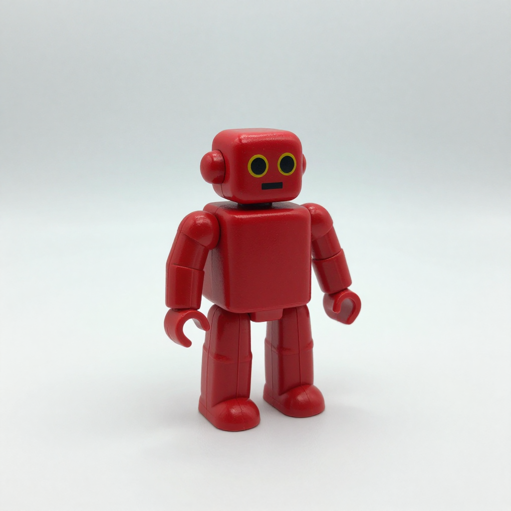
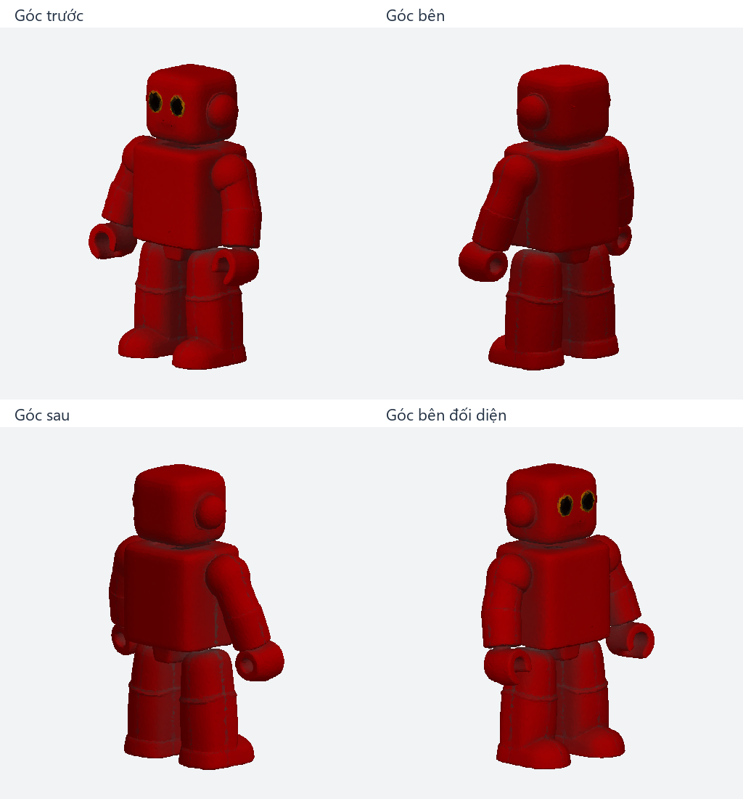

# ComfyUI MI50 Windows

Run **Z-Image GGUF image generation** and **TRELLIS.2 textured 3D generation** on an AMD Instinct MI50 through ComfyUI, HIP 5.7 and ZLUDA.

This repository packages the compatibility code, pinned installation recipes, API workflows and measured examples from a working **MI50 16 GB / Windows** setup. It is an experimental community port, independent of ComfyUI, AMD, Microsoft and NVIDIA.

**One repository, two optional profiles.** Z-Image users do not need to build the TRELLIS native extensions. Both profiles share the isolated Torch/HIP/ZLUDA runtime and SSD kernel cache.




Download the actual [textured robot GLB](examples/robot.glb). The four-angle preview is a CPU inspection render using the embedded base-color texture; it is not a final PBR render.

## Verified result

| Profile | Settings | Measured ComfyUI execution |
| --- | --- | ---: |
| Z-Image **NSFW v2 Q8_0** | 1024×1024, Euler/simple, 8 steps, CFG 1, seed 42 | **92.610 s** |
| TRELLIS.2-4B | Pipeline 1024, texture 1024, 12/12/12 steps, seed 42 | **515.38 s** |

The image is an ordinary toy robot despite the checkpoint's name. Z-Image sampling took 57.2 s. TRELLIS produced **96,781 triangles**, one material and two embedded textures. Z-Image had an existing kernel cache and a fresh worker; TRELLIS still compiled decoder kernels. These are single-example measurements, not fully warm throughput or an RX 6800 A/B comparison. See [benchmark details and provenance](benchmarks/README.md).

Only the MI50 16 GB configuration has completed these workflows. Other gfx906 devices, MI50 32 GB and Linux are unverified here. The tested Windows driver reports the card as `AMD Radeon Pro VII [ZLUDA]`.

## Install

Requirements: Windows x64, **Python 3.12**, Git, 7-Zip, a compatible installed AMD display driver and SSD space for the runtime/cache/models. TRELLIS source builds additionally require **Visual Studio 2022 Build Tools**, the C++ workload and a Windows SDK. The tested compiler was MSVC 14.44; native compilation uses one worker.

Clone this repository and work from its root:

```powershell
git clone https://github.com/tuandat3019/comfyui-mi50-windows.git
cd comfyui-mi50-windows
py -3.12 scripts/setup.py --profile image --plan
```

Read the dependency terms linked in [setup instructions](docs/setup.md). Then install the image profile:

```powershell
py -3.12 scripts/setup.py --profile image --accept-runtime-licenses
```

Add TRELLIS when needed, or use `--profile all` for both:

```powershell
py -3.12 scripts/setup.py --profile trellis --accept-runtime-licenses
```

Setup stages libraries locally; it does not run a display-driver installer, change system PATH, download model weights or start GPU inference. A complete existing HIP directory can be supplied with `--hip-bin`. An SSD runtime outside the checkout can be selected with `--runtime D:/AI/mi50-runtime`; pass the same value to subsequent commands. Keep the checkout path short for native builds.

See [model placement/download instructions](docs/models.md), then check installation files:

```powershell
py -3.12 scripts/launch.py --profile image --check
py -3.12 scripts/launch.py --profile trellis --check
```

`--check` verifies files only. A complete fresh-install GPU run of the extracted public package has not yet been repeated; the published GPU evidence comes from the original isolated test runtime. CPU checks cover the extracted math, patches, launch commands and installation helpers.

## Run

`--device` is the **HIP 5.7 ordinal**, which may differ from Vulkan/DirectML. The launcher exposes one GPU and checks its reported name before inference. Run one profile at a time and free that GPU from other applications yourself.

```powershell
py -3.12 scripts/launch.py --profile image --device 0
```

Open `http://127.0.0.1:8188`, or submit the API example from a second terminal:

```powershell
py -3.12 scripts/submit_workflow.py --port 8188 --workflow profiles/z-image/workflow-api.json --out-dir outputs/image-001
```

Stop that launcher with Ctrl+C before launching TRELLIS:

```powershell
py -3.12 scripts/launch.py --profile trellis --device 0
```

Open `http://127.0.0.1:8189`. The included reference already has a transparent background and padding:

```powershell
py -3.12 scripts/submit_workflow.py --port 8189 --workflow profiles/trellis2/workflow-api.json --image examples/robot-reference.png --out-dir outputs/mesh-001
```

The supplied JSONs are **API-format workflows**, submitted by this script or `POST /prompt`; they are not the editor's drag-and-drop workflow format. Generated PNG/GLB files are in `.runtime/outputs/<profile>`. Request history/timing are written to the chosen `--out-dir`. Cold kernel compilation can take much longer than the measured cached image run. Preserve `.runtime/zluda-cache` on SSD.

## Compatibility work

- Torch 2.7.1+cu118, torchvision 0.22.1+cu118, torchaudio 2.7.1+cu118; pinned ComfyUI and custom-node commits.
- HIP 5.7 runtime DLLs from the tested PRO26Q1 Vega/Polaris package, HIP5.7 library/RTC payloads and community gfx906 rocBLAS tables. Downloaded runtime archives have SHA-256 checks.
- cuDNN/Flash SDPA/BF16/cuBLASLt disabled; FP16 model computation, FP32 norm/softmax accumulation, 80% Torch allocator cap.
- Z-Image stage offload, sampler cache trimming, FP32 tiled VAE and GGUF padding-token compatibility.
- TRELLIS bounded SDPA, chunked explicit sparse GEMM and Torch weighted gathers; CPU batch counts/row uniqueness with results returned to the original device.
- CUDA 11.8/PTX-only builds of CuMesh/BVH/xatlas, FlexGEMM, nvdiffrast and o-voxel; CUB/MSVC/PTX compatibility patches and the upstream Python tiled-decoder helper.

These are inference profiles. Training, backward passes, arbitrary custom nodes, LoRAs, upscaling, antialias backward, simultaneous GPU workloads and mesh printability have not been validated. See [architecture](docs/architecture.md) and [troubleshooting](docs/troubleshooting.md).

## Development and attribution

```powershell
py -3.12 -m unittest discover -s tests -v
```

Tests need Torch for numeric checks. An optional CPU-only GitHub Actions template is included at [ci/checks.yml](ci/checks.yml); it is not an active workflow. The runtime sources, model weights, native binaries, kernel cache and private machine logs are excluded from Git.

Original orchestration/compatibility code is [MIT licensed](LICENSE). Third-party sources and the nvdiffrast-derived patch retain their own terms; see [THIRD_PARTY_NOTICES.md](THIRD_PARTY_NOTICES.md). This port builds on [ComfyUI](https://github.com/Comfy-Org/ComfyUI), [ComfyUI-GGUF](https://github.com/city96/ComfyUI-GGUF), [ComfyUI-Trellis2-AMD](https://github.com/dmonkman/ComfyUI-Trellis2-AMD), [TRELLIS.2](https://github.com/microsoft/TRELLIS.2), [CuMesh](https://github.com/visualbruno/CuMesh), [FlexGEMM](https://github.com/JeffreyXiang/FlexGEMM), [nvdiffrast](https://github.com/NVlabs/nvdiffrast), [ZLUDA](https://github.com/lshqqytiger/ZLUDA) and [community ROCm libraries](https://github.com/likelovewant/ROCmLibs-for-gfx1103-AMD780M-APU).

[Hướng dẫn tiếng Việt](README.vi.md)
